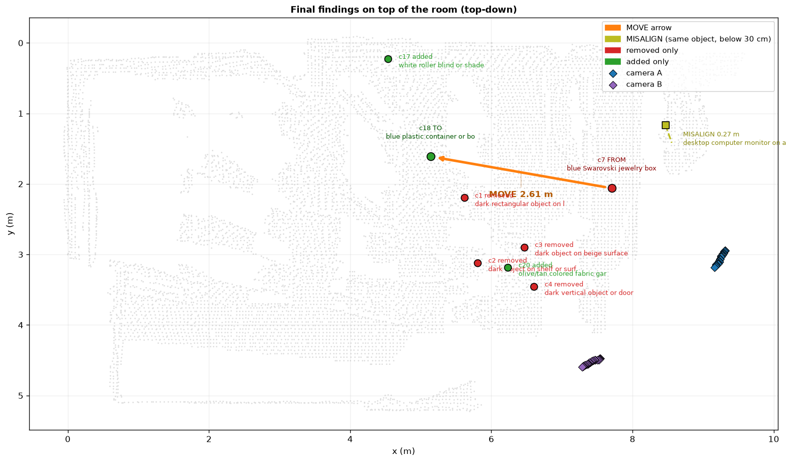
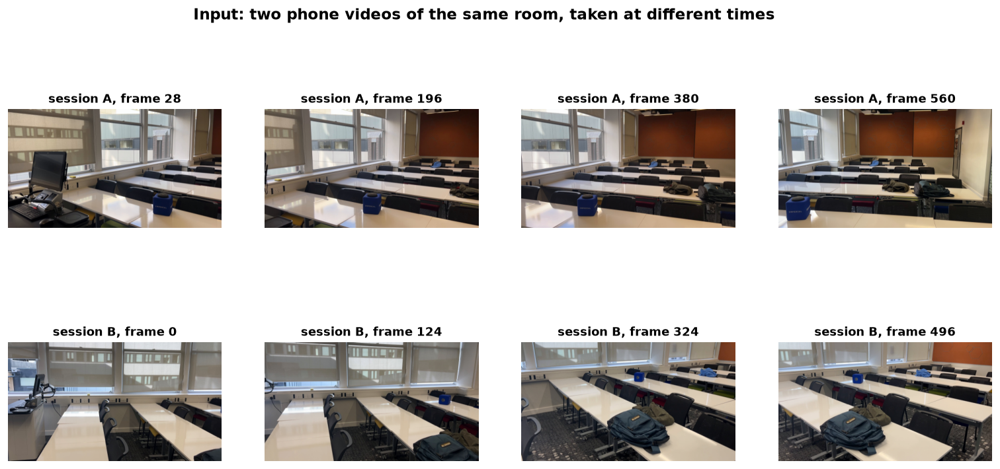
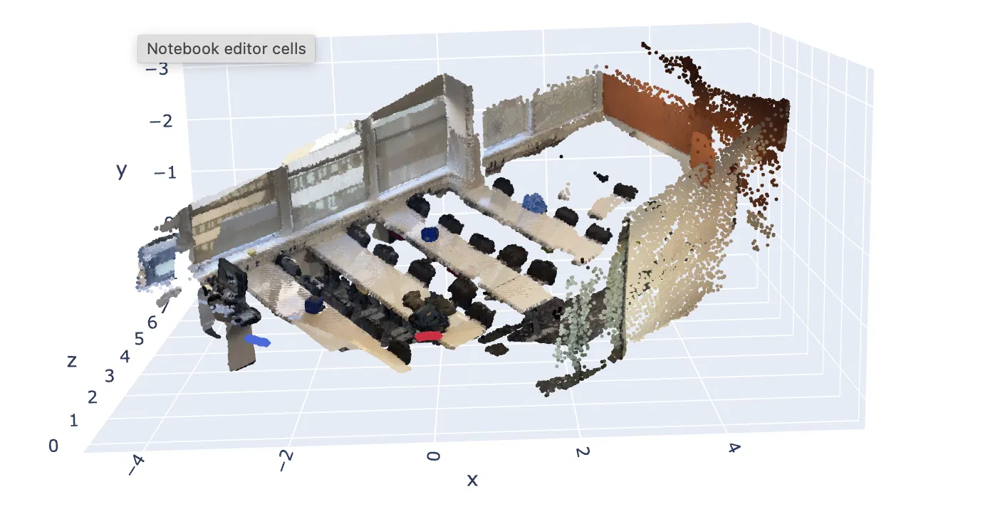
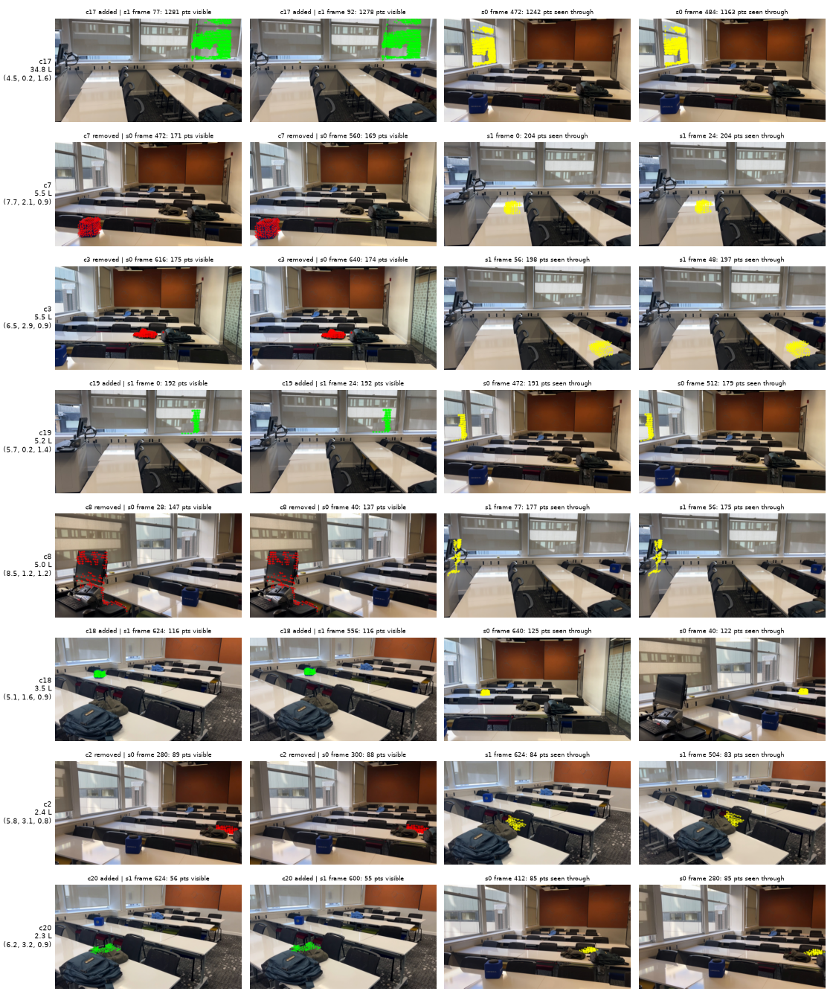
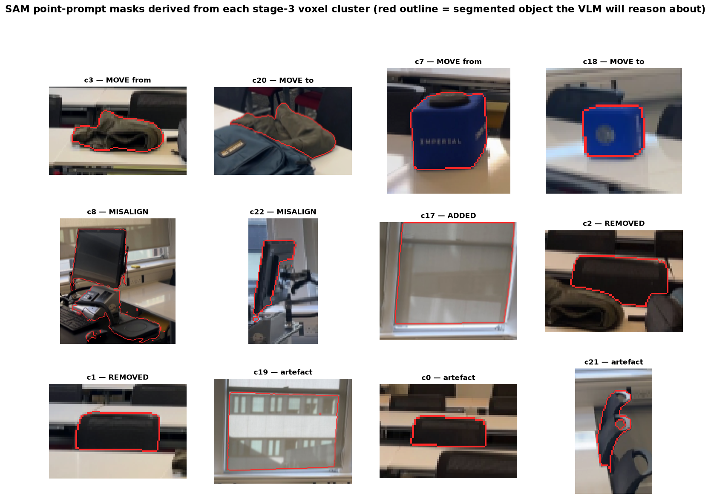
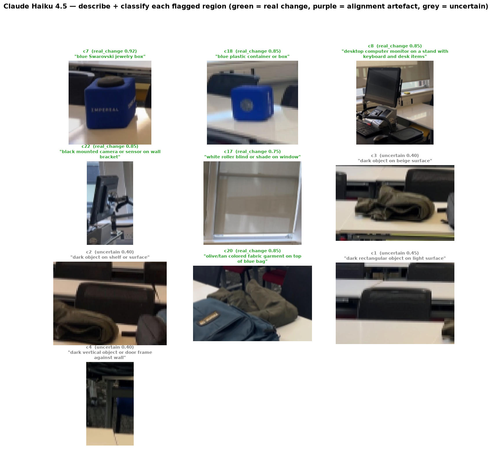
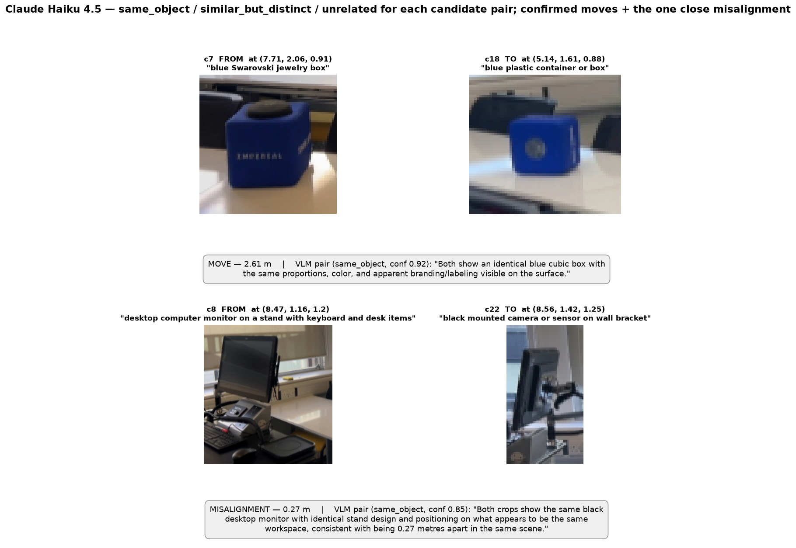

# What changed in the room?

> Given two phone videos of the same room taken at different times, this project reconstructs a shared 3D map, finds where things have changed, and describes each change in plain language.



The design in one line. Geometry comes first, semantics after. A deterministic 3D voxel diff decides *where* something changed, and a vision-language model (Claude Haiku 4.5) then explains *what* changed and whether it is a real change or just reconstruction noise.

---

## Example output

Running the pipeline on the included sample (two 20-second iPhone videos of a classroom) produces this `out/report.md`, authored by Haiku.

> **What changed**
>
> A blue jewelry box moved across the desk, several dark objects were removed, and a new garment and window blind were added.
>
> **Main changes**
> - Blue Swarovski jewelry box or blue plastic container, moved **2.6 m** (high confidence)
> - White roller blind or shade on window, added (low confidence)
> - Olive/tan fabric garment on top of blue bag, added (high confidence)
> - Dark object on beige surface, removed (high confidence)
> - Dark rectangular object on light surface, removed (high confidence)
>
> **Notes**
> - Desktop computer monitor setup and black mounted camera are closely positioned but may represent different objects rather than movement.
> - 5 small artefacts suppressed from analysis.

*Haiku 4.5 is the cheapest VLM in the Anthropic API and the only one that stayed inside what I could run end-to-end for free. Its naming is sometimes imaginative, so the blue cube is not actually a Swarovski box, but the move / add / remove / artefact decisions it makes on top of the geometry are consistent. Swapping Haiku for Sonnet or Opus, or for a model fine-tuned on object shapes, would probably clean up the labels without changing anything else in the pipeline.*

Open `out/changes_3d_vlm.html` in a browser to spin the scene around. `data/vlm.json` is the structured record every claim traces back to.

---

## How to run

### Quickest. Google Colab

Open **[`notebooks/run_pipeline_colab.ipynb`](notebooks/run_pipeline_colab.ipynb)** in Colab. The notebook installs dependencies, mounts a project folder you provide, runs stages 2–4 against the sample reconstruction, and renders the report, interactive 3D view, and seven walkthrough slides inline. No GPU required.

### Local

```sh
pip install -r requirements.txt

python room_frame.py                 # stage 2, align room frame
python diff.py                       # stage 3, voxel visibility diff
python show_clusters.py              # stage 3, evidence sheets (optional)

export ANTHROPIC_API_KEY=sk-ant-...
python vlm_reason.py                 # stage 4, Haiku semantics + report
python view3d_vlm.py                 # interactive 3D view
```

Stage 1 (the shared 3D reconstruction via Depth Anything 3) needs a GPU with ~16 GB VRAM. Run **[`notebooks/stage1_reconstruct_da3_kaggle.ipynb`](notebooks/stage1_reconstruct_da3_kaggle.ipynb)** once on Kaggle to produce `data/recon_da3.npz`. The sample run against the included one takes about two minutes on CPU.

---

## How it works

### 1. Input



Any pair of videos of the same room from different viewpoints. The sample is 46 keyframes extracted from two 20-second iPhone recordings.

### 2. Shared 3D reconstruction



Depth Anything 3 (metric variant) runs on all keyframes in a single pass and returns per-pixel depth and camera pose, in one shared metric coordinate frame. We fit the floor plane, snap the walls to the x/y axes, and place the origin at the floor corner so everything after this is in positive-metre coordinates.

### 3. Visibility-aware voxel diff



Both sessions are voxelised at 3 cm. A voxel is a candidate change if it is occupied in one session and empty in the other. For each candidate we project it into every frame of the opposite session and count three visibility states. *see-through* means the depth passed through (evidence of absence), *match* means something is at that depth, and *occluded* means no vote. A candidate is confirmed only if see-through votes dominate. Voxels nobody could verify are reported honestly as *"not compared"* rather than silently assumed unchanged.

### 4. Steered segmentation



For every flagged region we project its 3D voxels back into the owning session's best frame and feed those points to SAM as a *point prompt*. SAM returns a precise object boundary derived from the geometry, so the crop is tight to the real object instead of being a loose box full of surrounding furniture.

### 5. Describe and classify



For each clean crop, Claude Haiku 4.5 produces a short noun phrase and one of three verdicts. **real_change** (green), **alignment_artefact** (purple, subsequently suppressed), or **uncertain** (grey). The prompts are scene-agnostic and never mention chair, monitor, or any other object category.

### 6. Pair decisions



For every candidate `(removed, added)` pair where both sides are big enough and classified as real_change, Haiku sees both crops and returns one of **same_object**, **similar_but_distinct**, or **unrelated** with a short reason. Greedy best-first assignment, scored by `vlm_confidence × exp(-distance / 4 m)` so close same-object matches dominate. Pairs under 30 cm are tagged as likely alignment noise, not moves.

### 7. Final report


The structured output (`data/vlm.json`) feeds a final Haiku call that composes a short, scannable Markdown report. Every object description in the report is the VLM's own and nothing is invented.

---

## Design notes

- **Geometry first, semantics after.** The vision model never generates a change. It only describes, judges, and matches changes that geometry has already localised. False positives in detection or captioning cannot invent findings, only be filtered as noise.
- **Visibility-aware diff.** Every candidate voxel asks every opposite-session frame what it saw, where the answer is see-through, match, occluded, or out-of-view. The "not compared" category exists specifically to avoid silently reporting coverage gaps as "no change".
- **Steered segmentation.** 3D geometry becomes a 2D point prompt for SAM. The resulting mask is a precise object boundary the VLM can reason about as a single thing, not a loose box.
- **Scene-agnostic prompts.** No object vocabulary. The pipeline runs the same way on a kitchen, a workshop, or an airport lounge.
- **Deterministic traceability.** The report is composed by Haiku but every claim traces back to a cluster id, a crop file, and the exact VLM response that justified it, all in `data/vlm.json`.

---

## Project layout

```
recon.py                  shared helpers (load, unproject, project, pixel filters, to_room)
room_frame.py             stage 2 room-frame alignment
diff.py                   stage 3 voxel visibility diff
show_clusters.py          stage 3 evidence sheets
vlm_reason.py             stage 4 SAM point prompts, Haiku reasoning, final report
view3d_vlm.py             interactive 3D view (writes out/changes_3d_vlm.html)
make_showcase.py          regenerates showcase/ slides from the latest run
notebooks/
  run_pipeline_colab.ipynb        Colab runner for stages 2 to 4
  stage1_reconstruct_da3_kaggle.ipynb   Kaggle runner for stage 1
data/
  recon_da3.npz           stage 1 output (shared metric reconstruction, 46 frames)
  room_frame.npz          stage 2 output
  changes.json            stage 3 output (change clusters)
  changes_voxels.npz      stage 3 output (voxel centres per cluster)
showcase/                 7 PNGs used in this README
```

---

## Attribution

- **Depth Anything 3** (ByteDance Seed) gives monocular metric depth with intrinsics and extrinsics in one shared frame. The nested giant checkpoint is CC BY-NC 4.0.
- **SAM 2.1** (Meta) gives pixel-exact object masks from point or box prompts.
- **SuperMap** (Zhao et al., arXiv 2608.22896) is the source of the three-state visibility test for change detection.
- **Claude Haiku 4.5** (Anthropic) does the vision-language reasoning in stage 4.

---

## AI disclosure

I learned about this challenge the day before the deadline, so I relied on CLaude to do a lot of the heavy lifting on the implementation side, writing the scripts, running experiments against the data, and suggesting approaches (Depth Anything 3, the Grounding DINO exploration, the final geometry-first-then-VLM architecture) when I asked for direction. Making the decisions on when to change approaches in the design almost feels like the classic exploration vs exploitation problem. When LLMs can write code as fast as they do, it is easy to fall into the trap of letting them run wild in their endeavours. I tried my best to work iteratively and understand each result before moving forward, leaving a lot of the evaluation to myself. I feel like more time spent on specifying the problem to the AI and defining my own evaluation strategies in it through .md files would result in a much more efficient workflow, so this is something I'll try to improve in future iterations.
## A closing note

These were an intense ~25 hours. I'm proud of the results I obtained, given the amount of new tools and concepts I had to cover in such a short period of time. It feels amazing to arrive at something that works. I can still see all the potential improvements I couldn't implement in time, but surely will tackle during the next few weeks.
